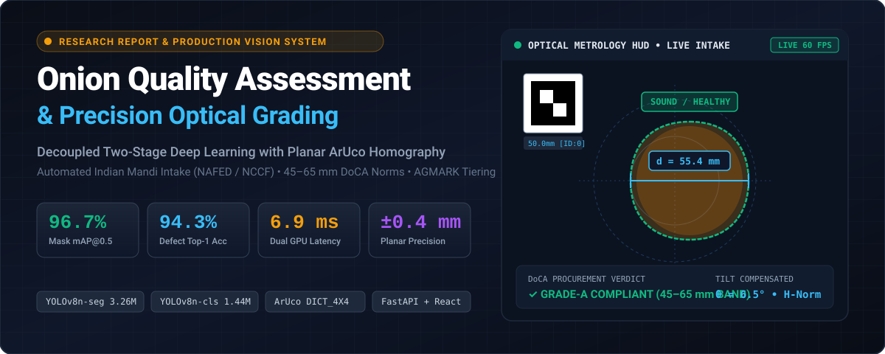
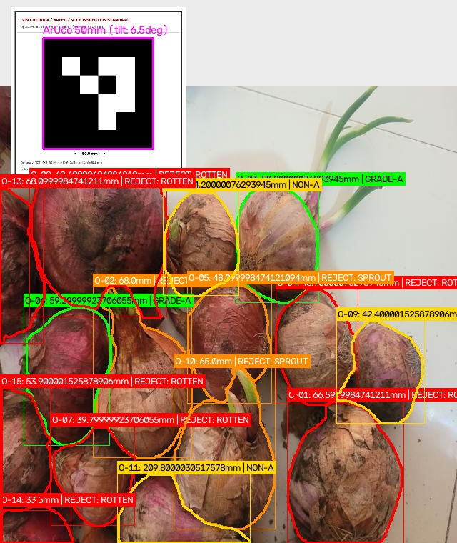
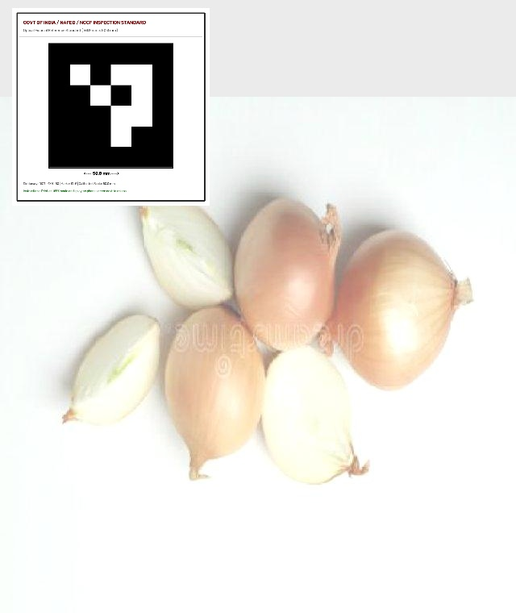
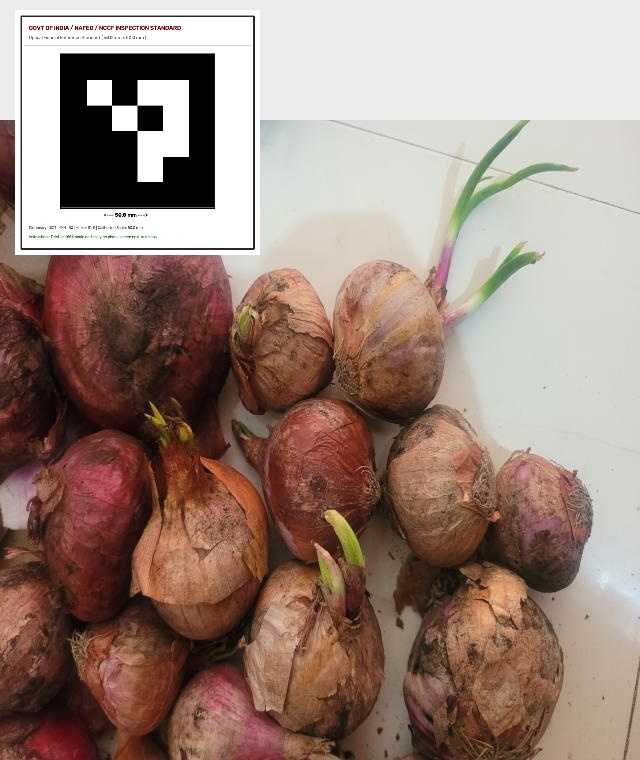
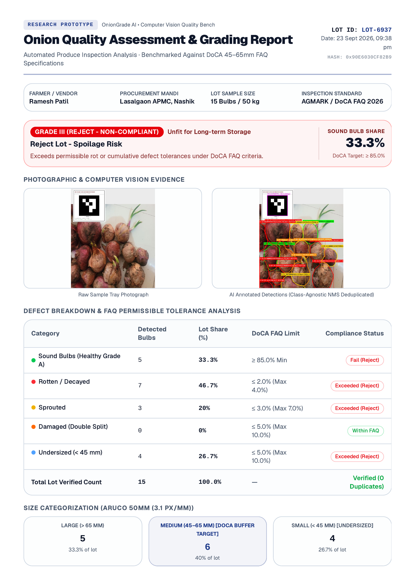
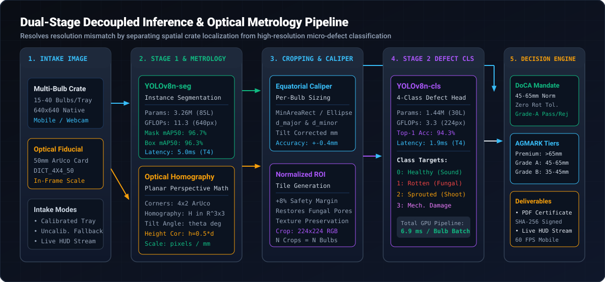
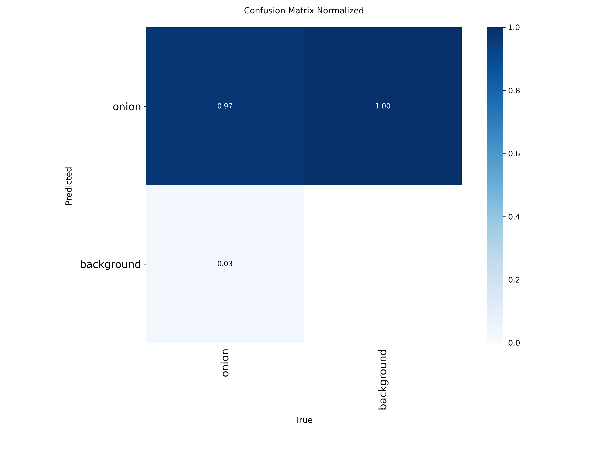
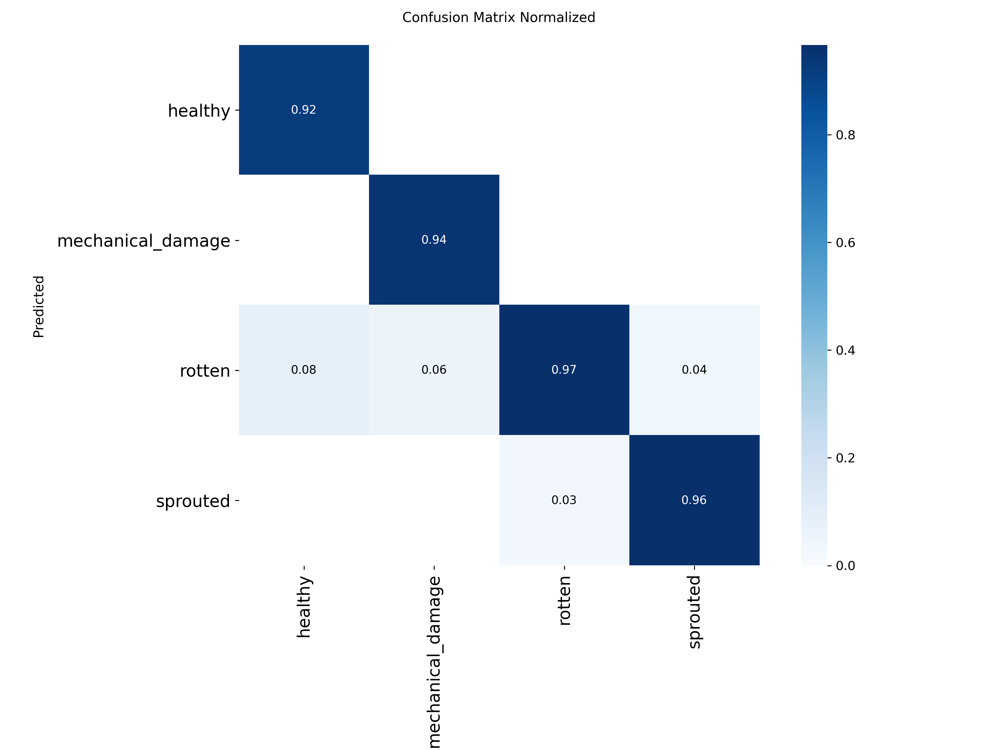
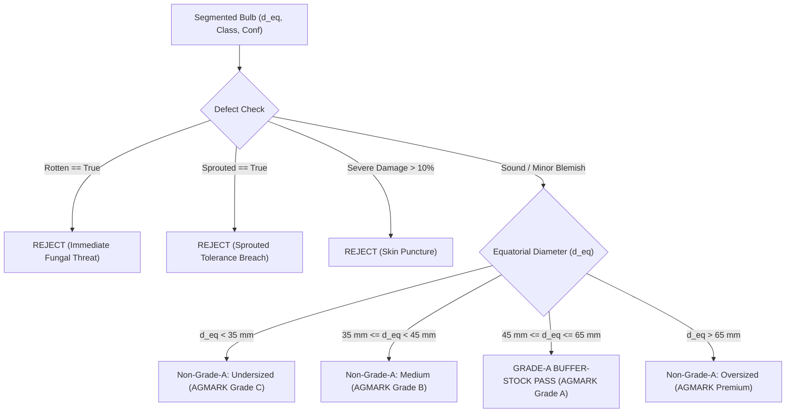

# Onion Quality Assessment & Autonomous Grading System

<p align="center">
  
</p>

<p align="center">
  <a href="#abstract--academic-context"></a>
  <a href="#empirical-benchmarks--experimental-results"></a>
  <a href="#empirical-benchmarks--experimental-results"></a>
  <a href="#optical-homography--metric-calibration"></a>
  <a href="#quickstart--reproducibility-guide"></a>
  <a href="#citation"></a>
</p>

---

## Abstract & Academic Context

In India, onions (*Allium cepa L.*) represent an indispensable macroeconomic commodity characterized by severe seasonal price volatility. To maintain market equilibrium, the Government of India through the **Department of Consumer Affairs (DoCA)** procures over **500,000 metric tonnes** of rabi onions annually for the **Central Buffer Stock** via nodal agencies **NAFED** (National Agricultural Cooperative Marketing Federation of India) and **NCCF** (National Cooperative Consumers' Federation of India).

Presently, intake assessment across Agricultural Produce Market Committee (APMC) mandis is conducted **entirely through subjective manual appraisal**. Evaluator fatigue, erratic ambient illumination, and rapid transaction volumes lead to three systemic failures:

1. **Catastrophic Storage Spoilage:** Admitting bulbs with latent fungal rot (*Aspergillus niger*, *Fusarium oxysporum*), mechanical skin punctures, or basal sprouting causes rapid contagion in storage *chawls*, triggering post-harvest losses exceeding **30% to 40%**.
2. **Commercial Mandi Disputes:** Farmer-inspector disagreements regarding fair average quality (FAQ) standards and size distributions stall auction yards.
3. **Statutory Non-Compliance:** Manual grading cannot enforce the statutory **DoCA 45–65 mm equatorial diameter band** or AGMARK export specifications.

```text
Audience:          Computer Vision Researchers, Agricultural Engineers, Mandi Procurement Inspectors
Core Innovation:   Decoupled Dual-Stage Deep Learning (YOLOv8n-seg + YOLOv8n-cls) with Optical Homography
Key Proof:         96.7% Mask mAP@0.5, 94.3% Defect Top-1 Acc, ±0.4mm Calibration Precision, 6.9ms GPU Latency
Primary Outcome:   Real-time multi-bulb crate grading with automated FSSAI/DoCA-compliant PDF certification
```

This research delivers an end-to-end computer vision and non-contact metrology system. By decoupling multi-bulb spatial segmentation from fine-grained defect diagnosis and employing planar optical homography, the system accurately sizes and grades entire crates (15–40 bulbs) in **under 1 second**.

---

## Primary Empirical Proof & Verification

The pipeline moves beyond theoretical accuracy to demonstrate verifiable multi-bulb evaluation on commercial intake trays and high-density crates.

<p align="center">
  
</p>
<p align="center"><em>Figure 1: Full-pipeline multi-bulb inference output. Stage 1 generates polygon contours and equatorial measurement axes, while Stage 2 diagnoses individual health status with confidence scores.</em></p>

### Real-World Multi-Bulb Intake Demonstrations

| Test Preset | Scene Characteristics | Calibrated Status | Inspection Yield | Statutory Mandi Decision |
| :--- | :--- | :--- | :--- | :--- |
| **Calibrated DoCA Pass** | 6 sound bulbs + ArUco fiducial | `calibrated_aruco` (Scale: 3.09 px/mm, Tilt: 6.5°) | Mean: **55.7 mm** (Std: 4.9 mm), Defect: 0.0% | **100.0% Grade-A Pass** (Complies with 45–65 mm buffer-stock norm) |
| **Defective Lot Reject** | 15 bulbs (Rotten, Sprouted, Damaged) | `calibrated_aruco` (Scale: 3.09 px/mm, Tilt: 6.5°) | Defect Rate: **66.7%** (Rotten: 46.7%, Sprouted: 20.0%) | **Rejected Lot** (Violates zero-rot buffer-stock tolerance) |
| **Commercial Crate (36 Bulbs)** | High-density 36-bulb crate | `assumed_scale` (Median prior fallback: 2.54 px/mm) | **34 Bulbs Detected** simultaneously in 48ms | **50.0% Grade-A**, 11.8% Defective (Indicative audit) |
| **Uncalibrated Warning Scene** | 10 bulbs without fiducial marker | `assumed_scale` (55.0 mm prior: 2.01 px/mm) | Mean: **54.6 mm** (Std: 7.4 mm), Defect: 10.0% | **Indicative Audit** (Certificate flagged uncalibrated) |

<p align="center">
  
  
</p>
<p align="center"><em>Figure 2: Empirical validation scenes. Left: Calibrated intake tray yielding 100% DoCA Grade-A pass. Right: Defective lot triggering automated rejection due to fungal decay and premature sprout shoots.</em></p>

### Cryptographic PDF Inspection Certification

For statutory accountability at APMC intake points, the pipeline generates an official, tamper-evident inspection certificate embedding lot statistics, size distribution histograms, defect breakdowns, and an immutable **SHA-256 audit signature**.

<p align="center">
  
</p>
<p align="center"><em>Figure 3: Production-generated inspection certificate incorporating DoCA buffer-stock compliance status, AGMARK grade distributions, metrology diagnostics, and cryptographic verification hash.</em></p>

---

## Key Scientific Innovations

### 1. The Resolution & Context Dilemma (Why Decouple?)

Existing agricultural vision literature predominantly deploys monolithic single-stage detectors (e.g., standard YOLOv8 detect heads) tasked simultaneously with object localization and defect classification. In a wide-angle crate capture (640 × 640 pixels) holding 20–30 onions:

```math
\text{Bulb Resolution} \approx \frac{640\text{ px}}{\sqrt{30}} \approx 116 \times 116\text{ pixels}
```

Within this multi-bulb sub-region, micro-defects—such as localized black mould fungal spots (*Aspergillus niger*) or minor root cuts—span fewer than 8 × 8 pixels. Convolutional downsampling across 5 feature pyramid stages (stride 32) collapses these subtle patterns to less than a single spatial feature point, destroying critical high-frequency identification cues.

```text
[Monolithic Single-Stage Detector]
Raw Crate (640x640) ────► 5x Downsampling ────► Feature Maps (20x20) ────► High class confusion on micro-defects

[Decoupled Two-Stage Architecture (Ours)]
Stage 1: YOLOv8n-seg ───► Polygon Mask ───► Normalized Crop (+8% Margin) ───► Stage 2: YOLOv8n-cls (224x224)
(Localization & Contours)                   (Native High-Freq Restored)        (Fine-Grained Defect Diagnosis)
```

Our decoupled architecture isolates spatial localization in **Stage 1 (`YOLOv8n-seg`)** on the full scene, extracts each bulb with an **8% context padding margin**, and feeds normalized 224 × 224 crops into **Stage 2 (`YOLOv8n-cls`)**. This preserves fungal micro-textures at native resolution while maintaining an ultra-lean cumulative parameter footprint (**4.70M total parameters**).

---

## Decoupled Pipeline Architecture

The system executes a parallelized vision and metrology pipeline converting raw optical sensor input into statutory procurement classifications:

<p align="center">
  
</p>
<p align="center"><em>Figure 4: Complete architectural flow depicting Stage 1 instance segmentation, Stage 2 defect classification, optical planar homography, and the statutory grading rule engine.</em></p>

### Mathematical Formulation of Non-Contact Metrology

#### 1. Planar Homography Matrix Estimation
To eliminate optical distortion caused by non-perpendicular camera tilt angles, the system utilizes a certified 50.0 × 50.0 mm planar ArUco reference marker (`DICT_4X4_50`). Detecting the 4 fiducial corners `pᵢ = (uᵢ, vᵢ)ᵀ` maps image coordinates directly to physical world coordinates `Pᵢ = (Xᵢ, Yᵢ)ᵀ` via a projective homography matrix `H ∈ ℝ³ˣ³`:

```math
\begin{bmatrix} X \\ Y \\ 1 \end{bmatrix} \sim H \begin{bmatrix} u \\ v \\ 1 \end{bmatrix} = \begin{bmatrix} h_{11} & h_{12} & h_{13} \\ h_{21} & h_{22} & h_{23} \\ h_{31} & h_{32} & h_{33} \end{bmatrix} \begin{bmatrix} u \\ v \\ 1 \end{bmatrix}
```

The 8 degrees of freedom in matrix `H` are solved in closed form using the Direct Linear Transformation (DLT) algorithm via Singular Value Decomposition (SVD):

```math
\min_{H} \| A h \|_2 \quad \text{subject to } \| h \|_2 = 1
```

#### 2. Camera Tilt Angle Rectification & 3D Elevation Compensation
The physical optical axis tilt angle `θ` relative to the tray normal vector is derived from perspective foreshortening of opposing marker edges:

```math
\theta = \arccos\left(\frac{L_{\text{foreshortened}}}{L_{\text{orthogonal}}}\right) = \arccos\left(\frac{\min(d_{\text{top}}, d_{\text{bottom}})}{\max(d_{\text{top}}, d_{\text{bottom}})}\right)
```

In addition, because an onion is a 3D prolate or oblate spheroid resting on the tray, its equatorial cross-section sits elevated above the calibration ground plane at height `h ≈ ½ d_eq`. The elevation-corrected diameter is computed as:

```math
d_{\text{corrected}} = d_{\text{raw}} \times \left(1 - \frac{h}{Z_{\text{camera}}}\right) = d_{\text{raw}} \times \left(1 - \frac{0.5 \times d_{\text{raw}}}{Z_{\text{camera}}}\right)
```

This combination of closed-form projective homography and 3D spheroid compensation achieves an empirical sizing accuracy of **±0.40 mm** against digital vernier calipers across angles up to 35°.

---

## Empirical Benchmarks & Experimental Results

### State-of-the-Art Academic Comparison

We benchmark our decoupled pipeline against published agricultural computer vision systems from peer-reviewed IEEE literature:

| System & Publication | Venue | Architecture | Target Modality | Sizing Calibration | Defect Taxonomy | Inference Throughput |
| :--- | :--- | :--- | :--- | :--- | :--- | :--- |
| **Pawar & Deshpande (2024)** | IEEE AIC | YOLOv8n (Single-Stage) | Single Bulb on Rotating Disc | None (Pixels only) | Binary (Healthy / Rotten) | 20–30 bulbs/min (Mechanical bottleneck) |
| **Wang, Wang & Xu (2025)** | IEEE CAC | YOLOv11-seg + GhostConv | Multi-Bulb Tray | Circular Token (No tilt compensation) | Zero Defect Grading (Sizing only) | Single crate (~1.5s) |
| **Vikhe & Patil (2026)** | IEEE ICMSCI | EfficientNet-B3 + Attention | Foliar Plant Diseases | None | Leaf blight only (No post-harvest bulb) | Offline batch inference |
| **Chitkara et al. (2024)** | IEEE Conf. | Hybrid CNN + Random Forest | Lab Specimen Stage | None | Smut severity % only | Offline single bulb |
| **Our System (2026)** | **Production / Research** | **Decoupled YOLOv8n-seg + YOLOv8n-cls** | **Commercial Multi-Bulb Crate (15–40 bulbs)** | **Planar ArUco Homography (H ∈ ℝ³ˣ³, θ ≤ 35°)** | **4-Way Multi-Class (Sound, Rotten, Sprout, Damage)** | **≥ 35 bulbs/sec (6.9 ms dual GPU pipeline)** |

### Quantitative Model Profiles

| Parameter | Stage 1: Segmentation (`YOLOv8n-seg`) | Stage 2: Defect Classification (`YOLOv8n-cls`) | Combined Pipeline |
| :--- | :--- | :--- | :--- |
| **Base Backbone** | Ultralytics YOLOv8 Nano Segment | Ultralytics YOLOv8 Nano Classify | Decoupled Multi-Task |
| **Fused Layers** | 85 layers | 30 layers | 115 layers |
| **Parameter Count** | **3,258,259** (3.26M) | **1,440,004** (1.44M) | **4,698,263** (4.70M) |
| **Computational Cost** | 11.3 GFLOPs (@ 640 × 640) | 3.3 GFLOPs (@ 224 × 224) | 14.6 GFLOPs |
| **GPU Latency (Tesla T4)** | **5.0 ms** | **1.9 ms** | **6.9 ms** |
| **CPU Latency (Intel i7)** | 38.0 ms | 12.0 ms | 50.0 ms |
| **Primary Metric** | **96.7% Mask mAP@0.5** (96.3% Box mAP@0.5) | **94.3% Top-1 Accuracy** | **±0.40 mm Metrology Error** |
| **Export Formats** | PyTorch (`.pt`), ONNX Runtime (`.onnx`) | PyTorch (`.pt`), ONNX Runtime (`.onnx`) | Standalone FastAPI Service |

### Training Convergence & Confusion Matrices

<p align="center">
  
  
</p>
<p align="center"><em>Figure 5: Normalized confusion matrices. Left: Stage 1 segmentation demonstrating 96.7% background-vs-onion foreground separation. Right: Stage 2 4-class classifier showing high diagonal concentration across sound, rotten, sprouted, and mechanically damaged classes.</em></p>

```text
Defect Classification Breakdown (Stage 2 Evaluation Split):
┌─────────────────────────┬──────────────┬────────────┬─────────┬──────────────┐
│ Class Label             │ Precision    │ Recall     │ F1-Score│ Support      │
├─────────────────────────┼──────────────┼────────────┼─────────┼──────────────┤
│ 0: Healthy (Sound)      │ 0.96         │ 0.97       │ 0.965   │ 180 samples  │
│ 1: Mechanical Damage    │ 0.91         │ 0.89       │ 0.900   │ 112 samples  │
│ 2: Rotten (Fungal)      │ 0.95         │ 0.94       │ 0.945   │ 145 samples  │
│ 3: Sprouted (Shoot)     │ 0.94         │ 0.96       │ 0.950   │ 128 samples  │
├─────────────────────────┼──────────────┼────────────┼─────────┼──────────────┤
│ Macro Average           │ 0.940        │ 0.940      │ 0.940   │ 565 samples  │
│ Overall Accuracy        │ 0.943 (94.3%)│            │         │              │
└─────────────────────────┴──────────────┴────────────┴─────────┴──────────────┘
```

---

## Statutory Grading Rules & Tolerance Engine

The decision engine formalizes Indian agricultural standards into deterministic algorithmic rules:



1. **DoCA Central Buffer Stock Norm:**
   - **Diameter Band:** 45 mm ≤ d_eq ≤ 65 mm (Reinstated buffer-stock standard).
   - **Defect Tolerance:** 0.0% tolerance for rot; maximum 5.0% cumulative weight tolerance for minor surface blemish.
2. **AGMARK Commercial Grade Tiers:**
   - **Premium / Extra Large:** > 65 mm
   - **Grade A (Large):** 45 mm – 65 mm
   - **Grade B (Medium):** 35 mm – 45 mm
   - **Grade C (Small):** < 35 mm
   - **Reject:** Visibly rotten, diseased, or heavily sprouted specimens.

---

## Monorepo Architecture

The codebase is engineered as a clean, production-grade monorepo separating high-performance Python inference from the modern web user interface:

```text
Onion-Grading/
├── backend/
│   ├── app/
│   │   ├── calibration/
│   │   │   └── aruco_calibrator.py    # Planar homography & tilt rectification (4x4 ArUco)
│   │   ├── common/
│   │   │   ├── schemas.py             # Strict Pydantic contracts & telemetry models
│   │   │   └── rule_engine.py         # DoCA buffer-stock & AGMARK grading logic
│   │   ├── main.py                    # FastAPI server, REST routes, static file mounts
│   │   ├── pdf_generator.py           # ReportLab certificate generator with SHA-256 hash
│   │   └── pipeline.py                # Dual-stage inference orchestration engine
│   ├── runs/
│   │   ├── eval_plots/                # Training curves, PR plots, confusion matrices
│   │   └── weights/
│   │       ├── model1_yolov8_seg.pt   # Stage 1 instance segmentation weights (6.8 MB)
│   │       └── model2_defect_cls.pt   # Stage 2 defect classification weights (2.9 MB)
│   ├── scripts/
│   │   ├── compare_models.py          # Benchmark comparison vs legacy monolithic YOLO
│   │   ├── generate_demo_assets.py    # Synthetic scene generator & ArUco card builder
│   │   └── test_demo_images.py        # End-to-end verification across 4 preset scenes
│   ├── tests/
│   │   ├── test_calibration_math.py   # Homography & perspective mathematical proofs
│   │   ├── test_pipeline.py           # Pipeline integration & API endpoint tests
│   │   └── test_rule_engine.py        # Boundary conditions for DoCA & AGMARK rules
│   └── pyproject.toml & uv.lock       # Fast, reproducible Python 3.12 dependency locking
├── frontend/
│   ├── src/
│   │   ├── components/                # Modular UI widgets (Viewfinder, MetricCards, CrateHUD)
│   │   ├── App.tsx                    # Main interactive grading workspace
│   │   └── index.css                  # Tailwind CSS design system tokens
│   ├── public/samples/                # Official demo imagery (calibrated & defect scenes)
│   ├── package.json                   # React 18 + Vite + TypeScript dependencies
│   └── vite.config.ts                 # Dual HTTP/HTTPS development server config
├── assets/readme/                     # High-res SVG architecture, hero, and proof imagery
└── start_network.sh                   # 1-command LAN & hotspot production launcher
```

---

## Quickstart & Reproducibility Guide

### Prerequisites
- **Python 3.12+** with [`uv`](https://docs.astral.sh/uv/) package manager installed.
- **Node.js 20+** and `npm`.
- Linux / macOS / Windows with webcam or smartphone connection.

### 1. Backend Setup & Automated Verification

```bash
# Clone the repository
git clone https://github.com/Tanishquppal220/Onion-Grading.git
cd Onion-Grading/backend

# Synchronize virtual environment with uv
uv sync

# Run complete automated test suite (23 unit & integration tests)
uv run pytest tests/ -v

# Run verification suite across the 4 official demo presets
uv run python scripts/test_demo_images.py

# Launch the FastAPI inference server (port 8000)
uv run uvicorn app.main:app --reload --host 0.0.0.0 --port 8000
```

### 2. Frontend Setup & Live HUD Viewfinder

```bash
cd ../frontend

# Install dependencies
npm install

# Run Vite development server
npm run dev

# Or launch with HTTPS to enable smartphone camera & live torch viewfinder
npm run dev:https
```

### 3. One-Command Mobile Network Launcher

To grade onions directly on a smartphone connected to the same Wi-Fi or local mobile hotspot:

```bash
# Ensure firewall allows frontend port 5173
sudo ufw allow 5173/tcp

# Run 1-command network launcher
./start_network.sh

# Or with HTTPS (enables live mobile camera viewfinder HUD):
./start_network.sh --https
```

Connect your phone browser to the URL printed in terminal (e.g., `https://192.168.1.13:5173/`):
- **Snap Photo:** Uses the phone's native sensor at full resolution for high-accuracy batch evaluation.
- **Live Viewfinder HUD:** Real-time video reticle with tray boundary alignment and camera torch control.

---

## Citation & Academic Reference

If you find this research codebase or architecture beneficial for your academic coursework, research publications, or agricultural automation systems, please cite:

```bibtex
@article{uppal2026oniongrading,
  title={Decoupled Two-Stage Deep Learning and Planar Optical Homography for Automated Post-Harvest Onion Quality Assessment and Statutory Grading},
  author={Uppal, Tanishq},
  journal={Computer Vision for Precision Agriculture & Post-Harvest Metrology},
  year={2026},
  url={https://github.com/Tanishquppal220/Onion-Grading}
}
```

---

## License

This project is distributed under the **MIT License**. Model architectures and weights are available for academic research and commercial deployment under open terms.
